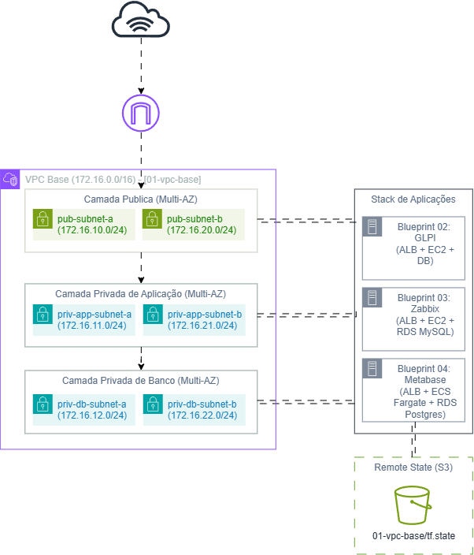

# Blueprints de Terraform e AWS

A proposta desse projeto é criar e documentar uma arquitetura de infraestrutura seguindo padrões corporativos de modularidade, alta disponibilidade segurança e governança de estado, utilizando Terraform e AWS

o pretenção é separar a camada de rede das demais camadas de computação e dados, permitindo que diferentes cargas de trabalho consumam a infraestrutura base de forma independente.

## Arquitetura Geral
>

O repositório é estruturado em módulos independentes:

| Blueprint | Diretório | Escopo da Arquitetura | Status |
| :--- | :--- | :--- | :--- |
| **01** | [`01-vpc-base`](./01-vpc-base/) | VPC, segmentação de subnets públicas e privadas em Multi-AZ, Internet Gateway, tabelas de rotas e backend remoto. | Completed |
| **02** | [`02-ec2-stack`](./02-ec2-stack/) | Provisiona a pilha de ALB, Aplicação e Banco de Dados desacoplada em três camadas| Completed |
| **03** | [`03-zabbix-rds-stack`](./03-zabbix-rds-stack/) | Provisiona a pilha de ALB, Aplicação e banco de dados relacional gerenciado (Amazon RDS MySQL) em subnets privadas dedicadas. | Completed |
| **04** | [`04-ecs-metabase-stack`](./04-ecs-metabase-stack/) | Provisiona a pilha de BI Metabase conteinerizada em AWS ECS Fargate (Serverless) com ALB público e banco de dados relacional gerenciado (Amazon RDS PostgreSQL) em subnets privadas dedicadas. | Completed |

## Pré-requisitos e Backend de Estado (S3)

Para garantir governança e concorrência segura, o tfstate é gerenciado remotamente em um Bucket S3 com versionamento habilitado.

Como o Terraform necessita do backend acessível durante a inicialização, o bucket deve existir previamente na conta AWS antes do comando `terraform init`:

Deixarei comentarios explicitos no main.tf e no variables.tf dos parametros que precisam ser alterados para refletir o ambiente que será utilizado

```bash
# 1. Defina o perfil configurado da AWS CLI
export AWS_PROFILE="YOUR-PROFILE"

# 2. Crie o bucket S3 destinado ao remote state
aws s3api create-bucket --bucket "YOUR-BUCKET-TFSTATE" --region us-east-1

# 3. Habilite o versionamento do bucket para segurança do remote state
aws s3api put-bucket-versioning --bucket "YOUR-BUCKET-TFSTATE" --versioning-configuration Status=Enabled
```
